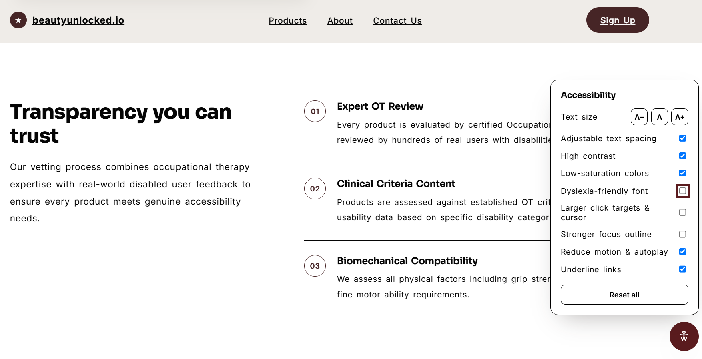

# beautyunlocked.io — accessible waitlist site

**[View the live site](https://waitlist-site-pearl-nine.vercel.app/)**

Pre-launch website for an early-stage startup client building a beauty directory for disabled people. I designed it, built it in vanilla HTML, CSS and JavaScript, and deployed it on Vercel.

## Why accessibility drives this project

The startup's promise is that beauty products are genuinely vetted for accessibility. The website is the first place a visitor can test that promise, so accessibility is both a usability requirement and part of the business case.

| Business goal                    | How the site supports it                                                                                           |
| -------------------------------- | ------------------------------------------------------------------------------------------------------------------ |
| Grow the waitlist                | Disabled visitors, the core audience, need to be able to read the page, navigate it and reach the signup form.     |
| Earn trust before launch         | The site demonstrates the product's values instead of only claiming them.                                          |
| Stay credible with the community | Avoiding bolt-on overlays reduces the risk of contradicting the "no accessibility-washing" message.                |
| Validate demand cheaply          | A coming-soon directory page tests interest before the directory is built.                                         |
| Keep costs and handover simple   | A static site, with Tally handling forms, needs no backend, and non-technical teammates can view signups in Tally. |

---

## Features

- **Accessibility toolbar:** a custom toolbar on every page, with nine settings:
  - text size
  - text and line spacing
  - high contrast
  - low saturation
  - dyslexia-friendly font
  - larger click targets and cursor
  - stronger focus outline
  - reduced motion, which also pauses autoplaying video
  - underlined links

- **Saved preferences:** settings persist across pages through `localStorage`. If storage is unavailable, the site falls back to the defaults.
- **Keyboard support:** each page has a skip link and visible focus styles. Pressing `Escape` closes the toolbar and returns focus to its toggle button.
- **System motion setting:** the CSS respects `prefers-reduced-motion`, so visitors don't need the toolbar to turn off transitions and smooth scrolling.
- **Assistive technology support:** the mobile menu and toolbar expose their open or closed state through `aria-expanded`.
- **Responsive layout:** the pages share one stylesheet, with breakpoints for tablet and mobile.
- **Waitlist and contact forms:** both are embedded Tally forms.
- **Demand tracking:** Google Analytics 4 runs on every page. The directory page fires a custom `directory_fake_door_view` event with the chosen category, such as mobility, sensory or sight, to show which needs attract the most interest.

## Key decision: custom toolbar vs. third-party overlay

I considered free overlay widgets such as UserWay and accessiBe, and decided against them. Overlays inject a script that tries to fix problems without changing the underlying code. Accessibility professionals and disabled advocates have documented that they can conflict with screen readers and other assistive technology ([Overlay Fact Sheet](https://overlayfactsheet.com/)).

For a brand built on genuine accessibility, that risk was too high. I built a small toolbar that uses simple CSS class toggles, with no third-party script and no AI-guessed fixes. Toolbar preferences stay in the visitor's browser.

The toolbar doesn't replace accessible code or testing with disabled users. It adds options on top of the base site.

## Key decision: plain HTML vs. React

I built the site in plain HTML, CSS and JavaScript because it's a mostly static 4-page site with little interactivity. React doesn't make a site inaccessible, since accessibility depends on the HTML it produces, but it wouldn't have solved any problem this site has.

A waitlist site usually needs only 1-3 core pages. This one has a landing page, a signup page and a contact page, plus a coming-soon directory page to test demand. Keeping it simple makes it easy for early-stage startups and marketing teams to set up quickly and start getting user feedback.

It would also have added risks I'd need to manage:

- **Performance:** visitors on older devices would download more JavaScript for no benefit.
- **Resilience:** without pre-rendering, a client-side React app shows a blank page if its JavaScript fails.
- **Navigation:** client-side route changes don't announce the new page or reset focus by default. Standard links between pages handle this natively.

The trade-off is duplication: the header, footer and toolbar are repeated on every page. That's manageable at this size. If it stops being manageable, a static site generator such as Astro would allow shared components while still shipping plain HTML. I'd reconsider React when the directory needs interactive features such as filtering, saved products or accounts.

## Tech stack

| Area      | Choice                                                       |
| --------- | ------------------------------------------------------------ |
| Design    | Figma, Google Stitch                                         |
| Front end | HTML, CSS, vanilla JavaScript, with no framework or packages |
| Forms     | Tally                                                        |
| Analytics | Google Analytics 4                                           |
| Hosting   | Vercel                                                       |

I used Google Stitch to explore the initial design, and refined the code through the steps shown in the commit history, including accessibility, responsiveness and deployment fixes.

## Known gaps

- It hasn't been tested with disabled users, and no formal WCAG audit has been done. The site doesn't claim WCAG conformance. However feedback has been given from occupational therapists.
- The accessibility of the embedded Tally forms hasn't been audited.
- Signup conversion isn't tracked yet. [SETUP.md](SETUP.md) describes the planned funnel events.

## Run locally

To build the site, you need Node 20.12 or newer. There are no packages to install.

1. Copy `.env.example` to `.env` and fill in every value.
2. Run `node build.js`.
3. Open `dist/index.html` in a browser, or serve the `dist` folder with any static file server.

Edit the source files, not `dist`. The build replaces `dist` each time and stops with an error if a value is missing.

> **Without Node:** you can skip the build and replace the values by hand.

See [SETUP.md](SETUP.md) for connecting Tally and Google Analytics.

## Using this as a template

Your form IDs, Analytics ID, contact email and business details go in `.env`, as described in [Run locally](#run-locally). On Vercel, add the same values under **Settings → Environment Variables**. `vercel.json` already sets the build command and output folder.

Replace the images and alt text before you publish. The hero, review and banner images in `index.html` are placeholder graphics, and each has the label `Write alt text here in plain language`. Screen readers will read that label aloud until you replace it with a description of your image.
